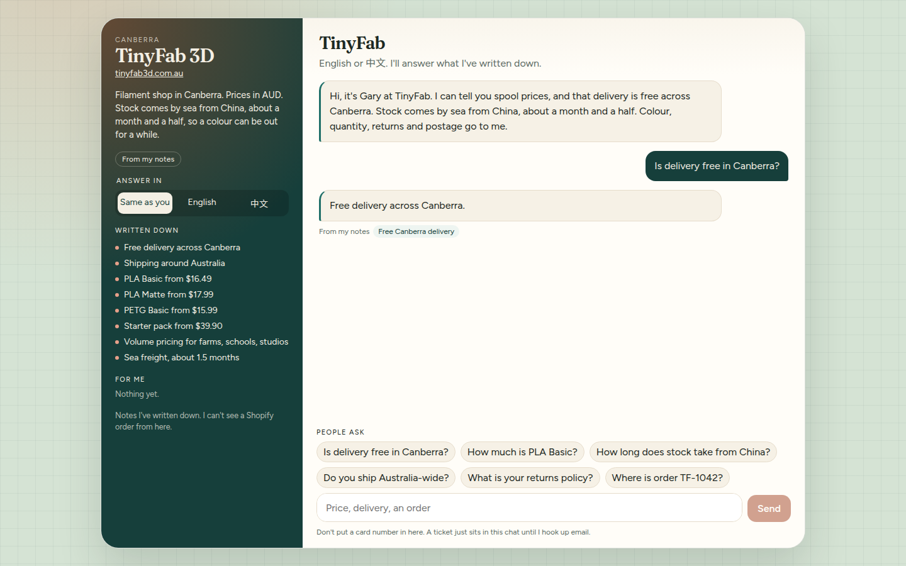
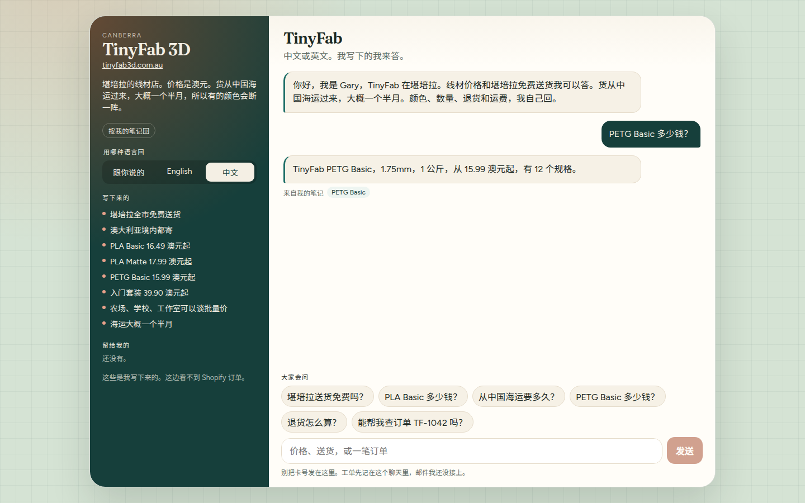
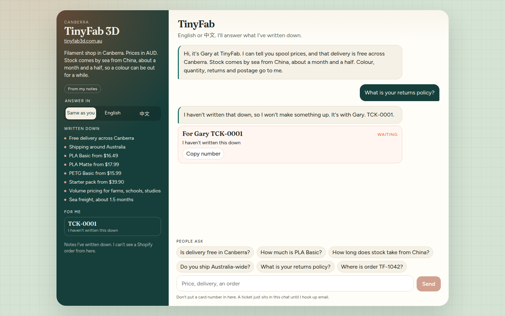

# TinyFab support chat

I run [TinyFab 3D](https://tinyfab3d.com.au), a filament shop in Canberra. Customers message me in English and in Chinese, and I'm one person, so I wrote this to answer the things I've already written down and pass me the rest.

## What it does

It reads a small set of notes and replies in the language of the message. There's a switch if you want to force English or 中文.

What it will answer:

- TinyFab PLA Basic 1.75mm 1kg, from $16.49, 14 variants
- TinyFab PLA Matte 1.75mm 1kg, from $17.99, 7 variants
- TinyFab PETG Basic 1.75mm 1kg, from $15.99, 12 variants
- Essential Starter Pack, from $39.90
- Free delivery across Canberra
- Shipping around Australia
- Volume pricing for print farms, schools, studios and businesses
- Stock comes by sea from China, about a month and a half, so a colour can be out of stock for a while

Material, colour and quantity go to me. So does anything I haven't confirmed: returns, the actual postage price, and how many days delivery takes. Those three are in the notes as `TODO: confirm with Gary`. The chat opens a ticket instead of inventing a rule. It also can't see Shopify, so a real order number becomes a ticket too.

No key is committed. Without `OPENAI_API_KEY` it reads the matching note back. With a key it sends that same note to the model.

## Screenshots

From my notes, no API key.









## How to run

Node 20 or newer.

```bash
npm install
npm run dev
```

Open http://localhost:5173. The API is on port 8787.

```bash
npm test
npm run lint
npm run build
npm start
```

```bash
cp .env.example .env
```

Put a key in `.env` if you want the model. Don't commit it.

```bash
docker build -t tinyfab-support .
docker run --rm -p 8787:8787 tinyfab-support
```

## Not done yet

- It does not look up orders. I haven't connected Shopify.
- Tickets stay in memory. I don't get an email when one is opened.
- Returns, exact postage, and delivery days are still unconfirmed. The chat will not guess them.
- I haven't run the Docker image on a server.

## TODO

- Confirm the return rules
- Confirm postage prices
- Confirm how many days Canberra and interstate delivery actually take
- Email me when a ticket is opened
- Read an order from Shopify once I'm ready to connect it
