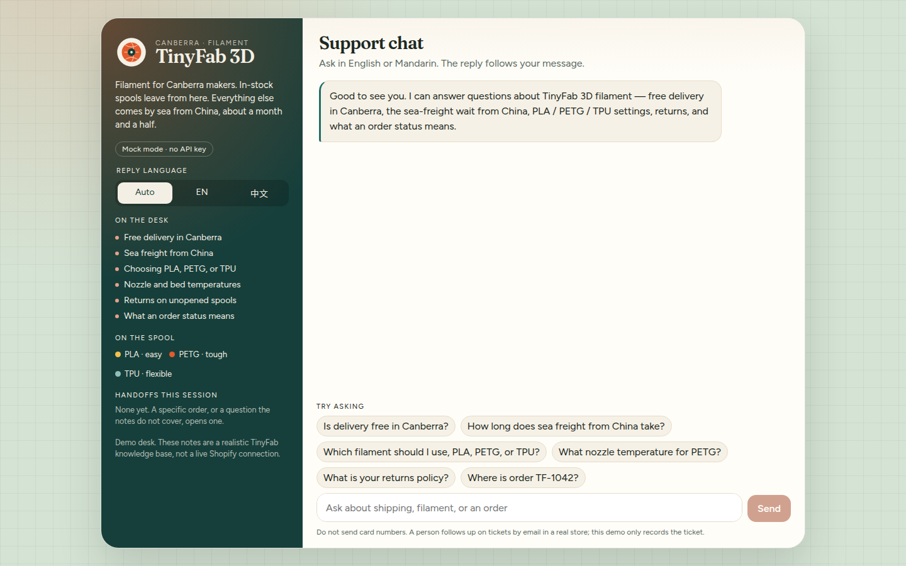
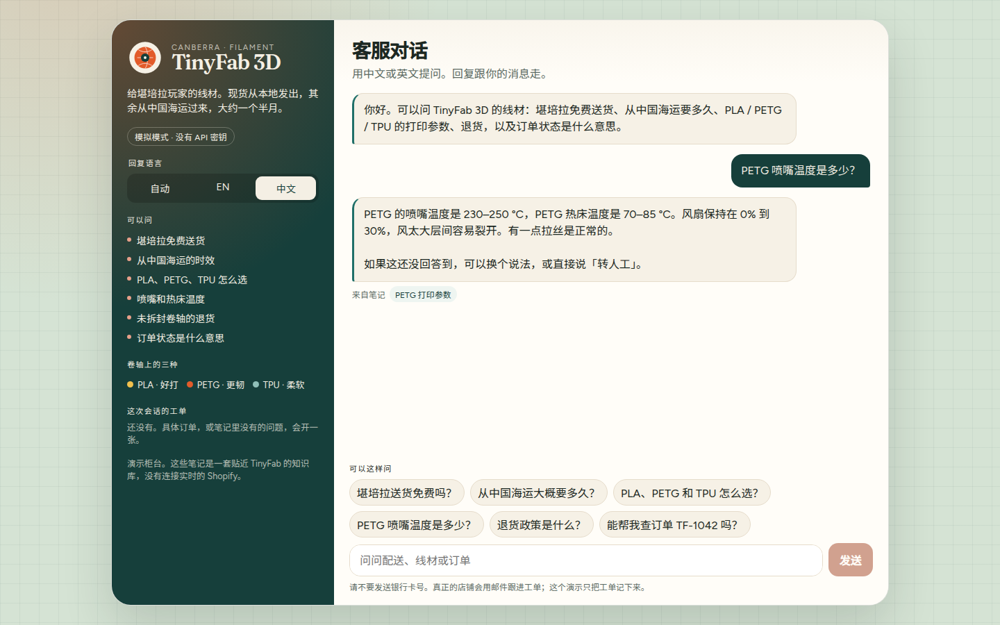
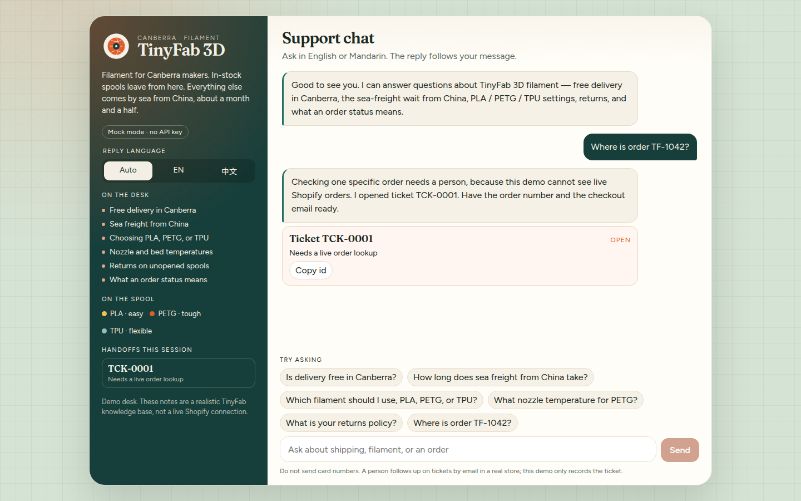
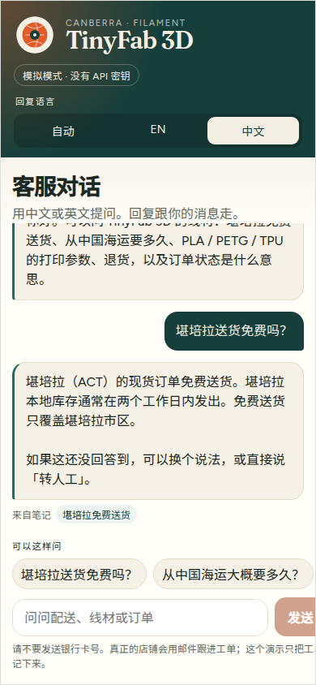
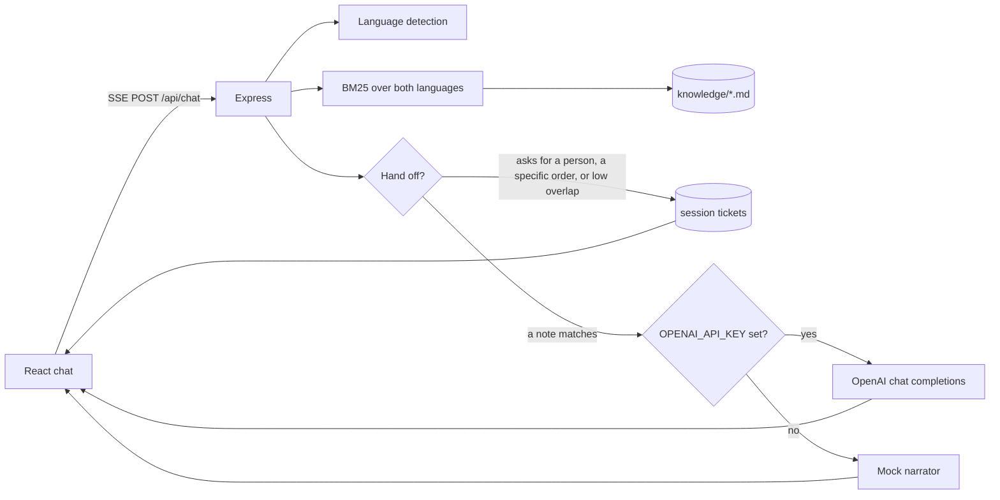

# AI Support Chatbot

Bilingual (English / Mandarin) AI customer-support chatbot — React + Node.js + LLM API.

A demo support desk for [TinyFab 3D](https://github.com/Gary709), an Australian Shopify shop that sells 3D printing filament. In-stock spools get free delivery in Canberra. The rest is shipped by sea from China and takes about a month and a half. The bot answers from a local knowledge base, in the language of the question, and opens a ticket when it should hand the customer to a person.

No API key is required. If `OPENAI_API_KEY` is unset, replies are a deterministic narration of the matching note, so the app demos and the tests run offline.

## What it does

- Chat UI with streaming replies, suggested questions, and an Auto / EN / 中文 control.
- Detects English or Mandarin on each message and answers in that language. The control can force one language; retrieval still finds the note from whichever language the customer wrote in.
- Retrieves from bilingual markdown notes with BM25 and Chinese character bigrams. No embeddings and no network in the default path.
- Hands off, and stores a ticket, when the customer asks for a person, asks about one specific order, or the notes do not cover the question.
- Uses OpenAI chat completions only when `OPENAI_API_KEY` is set. Greetings and handoffs stay templated in both modes.

The notes are a realistic demo script, not a live Shopify connection. The bot will not invent a tracking number, and it will not ask for a card number.

## Screenshots

Mock mode, no API key.










## Architecture



The browser talks only to the Express server. In development, Vite proxies `/api`. In production, Express serves the built client from the same origin.

## How to run

Node.js 20 or newer.

```bash
npm install
npm run dev
```

Open [http://localhost:5173](http://localhost:5173). The API listens on port 8787. The badge in the sidebar reads **Mock mode** until a key is set.

```bash
npm test
npm run lint
npm run format:check
npm run typecheck
npm run build
npm start   # API and the built client on port 8787
```

To use the live model, copy the example env file and set a key locally. Do not commit `.env`.

```bash
cp .env.example .env
```

`OPENAI_MODEL` defaults to `gpt-4o-mini`. `HANDOFF_CONFIDENCE` defaults to `0.34`.

Docker, still in mock mode unless you pass a key at runtime:

```bash
docker build -t tinyfab-support .
docker run --rm -p 8787:8787 tinyfab-support
```

```bash
docker run --rm -p 8787:8787 -e OPENAI_API_KEY=sk-... tinyfab-support
```

The image does not copy a `.env` file. Pass the key with `-e` or your orchestrator’s secret store.

## Knowledge base

`knowledge/en` and `knowledge/zh` are paired markdown files. The `id` matches across languages. The first paragraph is the sentence the mock narrator speaks. The rest is extra text for retrieval and for the live model.

Topics: Canberra delivery, shipping outside Canberra, sea-freight lead time, returns, choosing PLA / PETG / TPU, printer settings for each, what an order status means, payment, and storing filament.

Two facts come from how the shop operates: free delivery in Canberra, and sea freight from China of about one and a half months. Other operational colour in the notes (a 30-day window on unopened spools, dispatch usually within two business days, the 95A TPU, the temperature ranges) is demo policy for this fictional desk, not a quote of a live returns contract.

## Design decisions

**Language.** Each message is classified by script. A Han character counts as two Latin letters, so a short Chinese question with an English product name such as `PETG 喷嘴温度` stays Chinese, while a mostly English sentence that opens with `你好` stays English. Auto follows the message. EN or 中文 forces the reply and the surrounding chrome. Search runs over both languages, then the answer is taken from the twin article in the reply language.

**Retrieval.** BM25 with English word tokens and Chinese bigrams, so Mandarin does not need a segmenter. A separate overlap score, the share of query tokens found in the winning note, is the confidence value. BM25 ranks; the overlap score decides whether the note is good enough to say out loud. Threshold is `HANDOFF_CONFIDENCE` (default 0.34).

**Handoff is not left to the model.** The rules are ordinary functions with unit tests. A person is requested, a specific order number or “where is my order” comes in, or confidence is below the threshold. “How do I check an order status?” stays with the bot, because that answer is in the notes. A greeting does not open a ticket. The ticket id is minted before the reply is streamed, and `GET /api/tickets?sessionId=` returns only that session’s tickets.

**One provider interface, two implementations.** Mock mode quotes the matched summary, so a demo cannot drift between runs. With a key, the same summary and body are the only context the model is given, and it is told to answer in the chosen language and not invent policy. Greetings, clarifications, and handoffs never call the API.

**Orders.** This process cannot see Shopify. Looking up `TF-1042` opens a ticket instead of a made-up status.

**Tickets** are in memory for the life of the process. That is enough to show the handoff record. It is not a support queue.

## Tests

`npm test` covers retrieval ranking (including Mandarin), language detection, the handoff rules, ticket ids, and the SSE chat route in mock mode. The route test checks that a Canberra question streams a grounded answer and that an order lookup is stored for that session only.

CI on GitHub Actions runs lint, Prettier, typecheck, the tests, and a production build.

## Next steps

- A staff screen to read and close tickets, and a real email to the customer.
- Read-only Shopify order lookup behind a staff login, so a ticket is only opened when the API cannot see the order.
- Embeddings once the notes are too large for keyword overlap, kept behind the same search function.
- A labelled set of real customer questions to tune `HANDOFF_CONFIDENCE`, instead of the threshold chosen for this demo set.
- Persist tickets outside the process.

## Author

Gary Chen ([@Gary709](https://github.com/Gary709))
